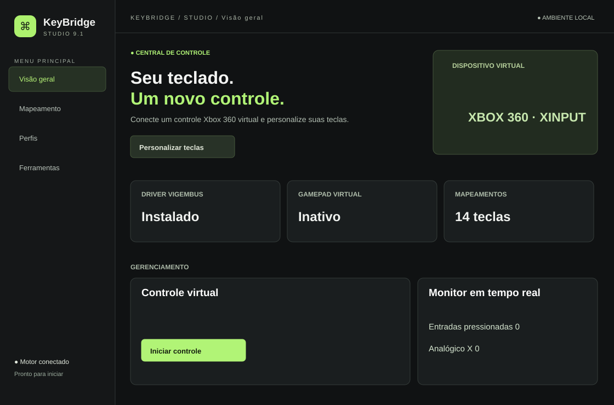
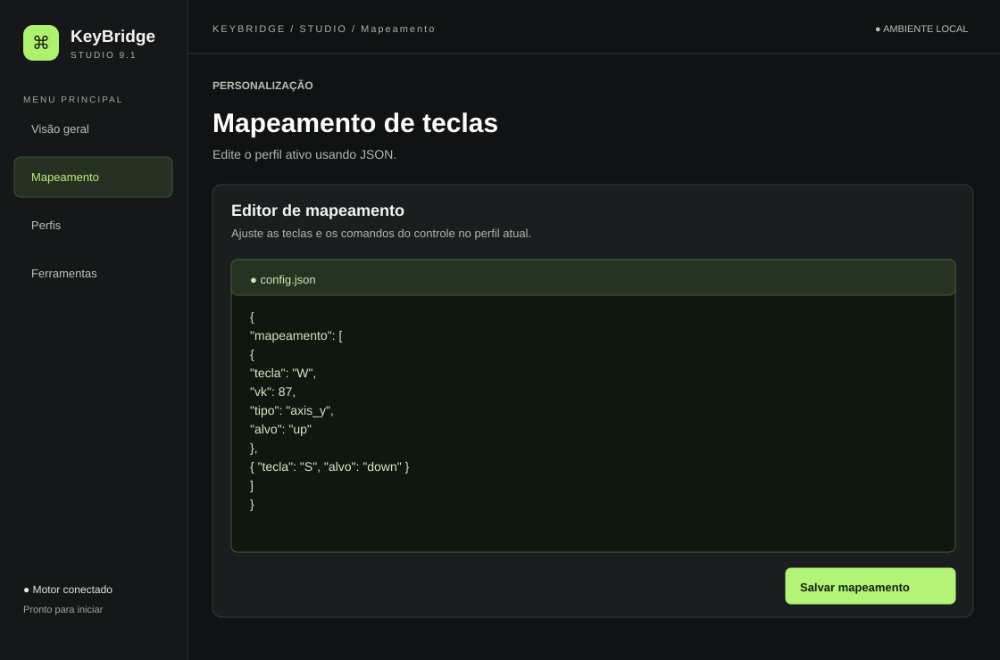
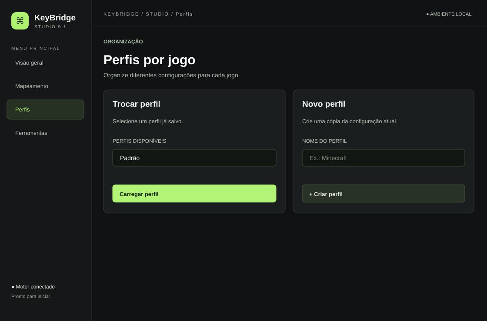
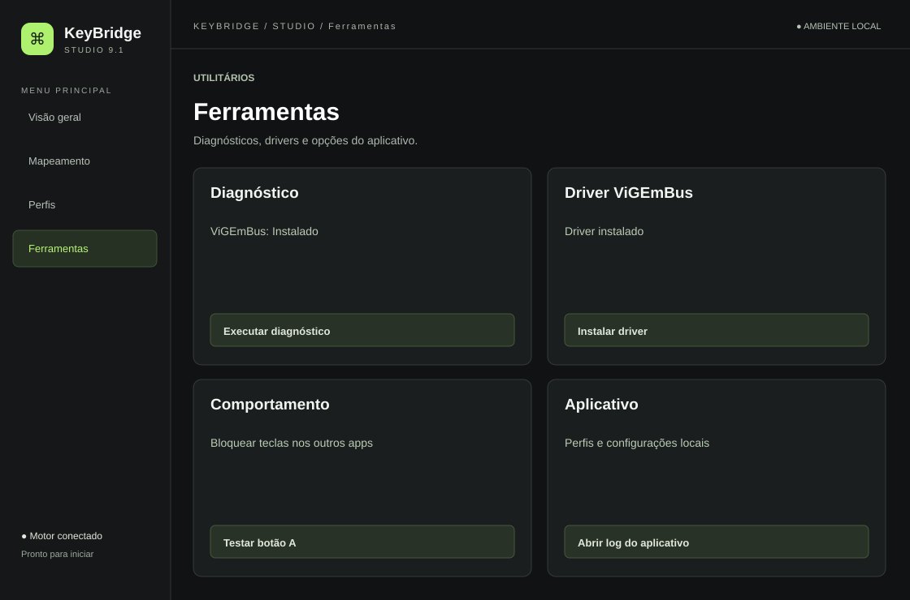

# KeyBridge Studio

**Seu teclado. Um novo controle.**

Mapeie o teclado para um controle Xbox 360 virtual no Windows.

[Download](https://github.com/Reivison009/KeyBridge/releases) · [Guia de uso](docs/GUIA-DE-USO.md) · [Requisitos](docs/REQUISITOS.md) · [Reportar problema](https://github.com/Reivison009/KeyBridge/issues/new/choose)

---

## Sobre

O KeyBridge foi criado para quem precisa usar o teclado em jogos que oferecem suporte a controle. Você escolhe as teclas, ajusta o mapeamento e inicia o controle virtual pela própria interface.

O aplicativo conta com quatro áreas:

- **Visão geral:** conexão do controle, estado do driver e monitoramento das entradas.
- **Mapeamento:** configuração das teclas em JSON, com opções para salvar e restaurar.
- **Perfis:** configurações separadas para diferentes jogos.
- **Ferramentas:** diagnóstico, teste de botões e acesso aos registros do aplicativo.

## Interface

Prévia vetorial das telas do KeyBridge Studio 9.1, baseada na interface do aplicativo.

### Visão geral

### Mapeamento

### Perfis

### Ferramentas

As imagens acima são recriações em SVG da interface, não capturas de tela idênticas.

## Download

As versões publicadas ficam na página de [Releases](https://github.com/Reivison009/KeyBridge/releases).

| Versão | Disponibilidade |
| --- | --- |
| **9.0** | Disponível para download |
| **9.1** | Em preparação, com arquivos separados para 32 e 64 bits |

A versão 9.1 terá dois downloads:

- `KeyBridge-x64.exe` — Windows 64 bits
- `KeyBridge-x86.exe` — Windows 32 bits

**Os arquivos da versão 9.1 ainda não foram enviados ao Releases.** A versão 9.0 continua disponível.

## Antes de usar

O KeyBridge utiliza **WebView2** para a interface e **ViGEmBus** para criar o controle virtual. Dependendo do computador, pode ser necessário instalar esses componentes.

Nem todos os jogos aceitam controles virtuais. O aplicativo não foi desenvolvido para contornar sistemas anticheat.

Para configurar as teclas, consulte o [guia de uso](docs/GUIA-DE-USO.md).

## Projeto

- [Novidades e versões](CHANGELOG.md)
- [Próximas melhorias](docs/ROADMAP.md)
- [Preparação da versão 9.1](docs/RELEASE-9.1.md)
- [Segurança](SECURITY.md)

Encontrou um erro? [Abra uma issue](https://github.com/Reivison009/KeyBridge/issues/new/choose) com a versão utilizada, o que aconteceu e, se possível, como reproduzir o problema.

---

Desenvolvido por <a href="https://github.com/Reivison009">Reivison009</a>

