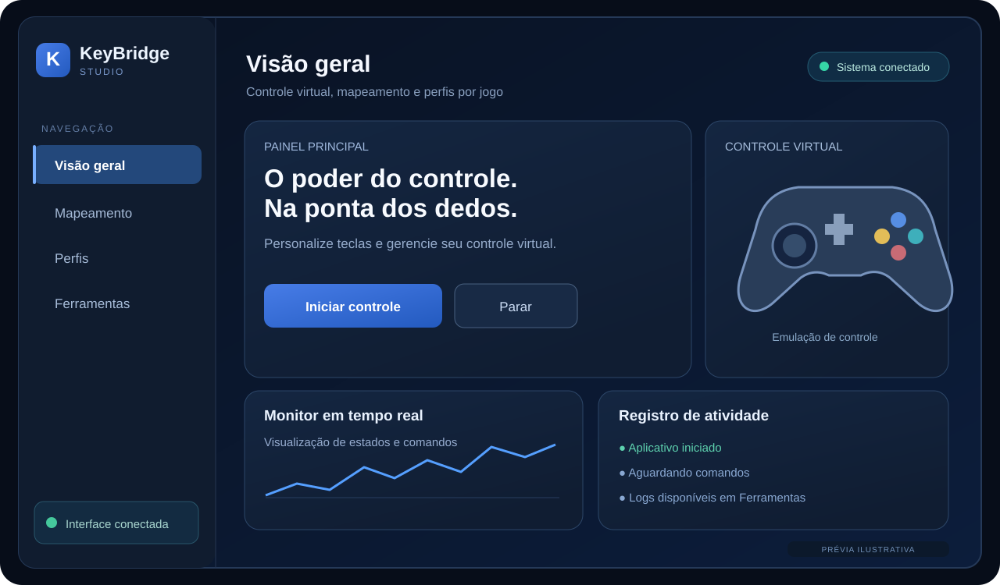

 

**Transforme comandos do teclado em ações de um controle virtual no Windows.**

[**DOWNLOADS**](https://github.com/Reivison009/KeyBridge/releases) · [**GUIA DE USO**](docs/GUIA-DE-USO.md) · [**ROADMAP**](docs/ROADMAP.md) · [**SUPORTE**](https://github.com/Reivison009/KeyBridge/issues/new/choose)

---

## O que é o KeyBridge?

O **KeyBridge Studio** é um projeto para Windows que permite configurar teclas do computador para controlar uma entrada virtual compatível com jogos e aplicativos. O projeto enviado inclui um motor em **C/C++**, interface própria em **HTML, CSS e JavaScript** e integração com **WebView2** e **ViGEm**.

O objetivo é facilitar o mapeamento sem obrigar o usuário a editar arquivos de configuração manualmente.

## Interface

  

Representação ilustrativa baseada na organização da interface do projeto. Não é uma captura de tela do programa em execução.

## Recursos do projeto

| Módulo | Funcionalidade |
| :--- | :--- |
| **Visão geral** | Iniciar e parar o controle virtual, acompanhar a atividade |
| **Mapeamento** | Configurar teclas, recarregar, salvar e restaurar o padrão |
| **Perfis** | Criar, carregar e alternar configurações por jogo |
| **Ferramentas** | Diagnóstico, teste de botão, logs e acesso ao instalador do driver |
| **Instalação inicial** | Escolher onde os recursos internos do programa serão extraídos |

Esses recursos foram identificados nos arquivos fornecidos do KeyBridge Studio 9.0. **Eles ainda não representam um certificado de testes em todas as máquinas.**

### Exemplo de mapeamento inicial

| Teclas | Função |
| :--- | :--- |
| `W` `A` `S` `D` | Movimento do analógico esquerdo |
| `J` `K` `L` `U` | Botões A, B, X e Y |
| `Shift` / `Enter` | LB / RB |
| `Q` / `E` | LT / RT |
| `Espaço` / `Backspace` | START / BACK |

**[Ver guia de configuração completo →](docs/GUIA-DE-USO.md)**

## Download e instalação

> **Status:** nenhuma release pública foi publicada até a última verificação. O botão abaixo levará às versões assim que forem disponibilizadas.

  

Quando uma versão estiver disponível:

1. Abra a página [Releases](https://github.com/Reivison009/KeyBridge/releases).
2. Na versão desejada, localize **Assets** e baixe `KeyBridge.exe`.
3. Execute o aplicativo e siga as instruções de instalação.
4. Se solicitado, instale os componentes necessários por suas fontes oficiais.

O projeto utiliza **WebView2 Runtime** para exibir a interface e **ViGEmBus** para o controle virtual. [Confira os requisitos e dependências](docs/REQUISITOS.md).

## Desenvolvimento e atualizações

O planejamento está disponível no [**Roadmap do KeyBridge**](docs/ROADMAP.md). As próximas prioridades são publicar a primeira release testada, validar a instalação em diferentes máquinas e implementar a verificação de atualizações pelo GitHub.

Para quem publica versões:

- [Guia de publicação do EXE](docs/PUBLICAR-ATUALIZACAO.md)
- [Histórico de alterações](CHANGELOG.md)
- [Política de segurança](SECURITY.md)

> A API de releases do GitHub está disponível, mas o recurso de atualização automática do EXE ainda precisa ser implementado e testado.

## Suporte e sugestões

Encontrou um erro ou tem uma ideia? Use os formulários prontos:

- [**Reportar um bug**](https://github.com/Reivison009/KeyBridge/issues/new/choose)
- [**Sugerir uma funcionalidade**](https://github.com/Reivison009/KeyBridge/issues/new/choose)

Inclua a versão do programa, o que você fez e o resultado observado. Antes de enviar logs, remova dados pessoais.

---

  <strong>KeyBridge Studio</strong> 
  Projeto de <a href="https://github.com/Reivison009">Reivison009</a> · Seu teclado. Seu controle.

